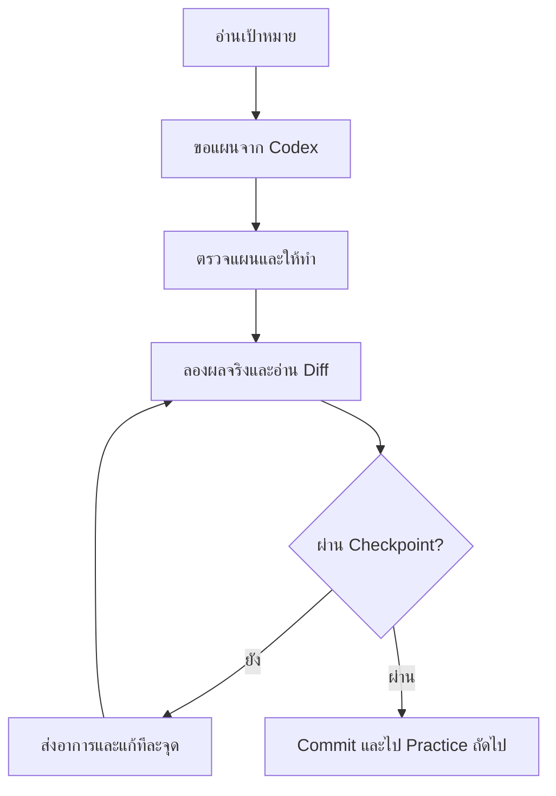

# Service Desk Lite — จาก Power Apps Maker สู่แอปที่ใช้งานผ่าน Cloud

สวัสดีครับ ในสี่วันนี้เราจะสร้าง **แอป Service Desk** ของบริษัทสมมติ BrightDesk ด้วย Codex ใน **ChatGPT desktop app** ตั้งแต่เก็บประวัติงาน สร้าง API ทำหน้าจอ Flutter ไปจนถึงเปิดแอป Android ให้เชื่อมกับ API บน Azure

## เนื้อหาที่เราจะเรียนตลอด 4 วัน

| วัน | Overview theme | สิ่งที่เราจะเพิ่มในโปรเจค | ผลลัพธ์ |
| --- | --- | --- | --- |
| [Day 1 — Git](/exercises/day-01-git/) | วางInstructionก่อนสร้าง: ทำงานกับ AI อย่างตรวจสอบได้ | Project brief, AGENTS.md, branch, commit, PR และ merge conflict | อธิบาย diff และชี้ merged PR ของตนได้ |
| [Day 2 — Python API](/exercises/day-02-api/) | เปลี่ยนแบบฟอร์มให้เป็นบริการข้อมูล | FastAPI, validation, Azure PostgreSQL, login/token และ test | สร้าง Request จริง; คนอื่นเปิด Request นี้ไม่ได้ |
| [Day 3 — Flutter](/exercises/day-03-flutter/) | นำบริการมาอยู่ในมือผู้ใช้ | Sign in, list/detail, create/update, UI states และ Android | ส่ง Request จากหน้าจอแล้วพบใน API |
| [Day 4 — Azure](/exercises/day-04-azure/) | ย้ายเคาน์เตอร์ไปเปิดบน Cloud | Docker, ACR, Container Apps, GitHub deployment, revision/log | Android เรียก HTTPS API; ตามรอยถึง commit ได้ |

จบหลักสูตรเป็น **ต้นแบบสำหรับเรียนรู้และต่อยอด** ยังไม่ใช่ระบบบริษัทที่ผ่านการรับรองใช้งานจริง เราไม่สร้าง chatbot หรือเพิ่ม OpenAI API เข้าไปในแอป; Codex ช่วยเราพัฒนาและตรวจงาน

## ก่อนเริ่ม

1. ทำ [แบบตรวจความพร้อม](/resources/readiness) ก่อนวันแรก โดยเฉพาะ Android SDK และ Docker ซึ่งติดตั้งนาน
2. ดาวน์โหลด [starter ZIP](/files/service-desk-starter.zip) แล้วแตกไฟล์ จะได้โฟลเดอร์ `service-desk-lite` สำหรับทำงานทั้งสี่วัน
3. เปิดโฟลเดอร์นี้เป็น **local project** ใน ChatGPT desktop app แล้วเลือก **Codex**. ไม่ต้องใช้ VS Code
4. หากได้รับ Student ZIP ส่วนตัว ให้เก็บแยกจาก public starter; เมื่อถึงวันที่ 2 ให้คัดลอกเฉพาะ `api/.env` ที่ได้รับ
ไม่แตกไฟล์ zip ทับทั้งโปรเจคหรือแทน `.gitignore`. Database และ app passwords เตรียมไว้แล้ว ต้องคงค่าเดิมระหว่าง seed rerun
5. เริ่มจาก Day 1 และใช้โฟลเดอร์เดิมต่อไป อย่าสร้างโปรเจคใหม่ทุกวัน.
6. Day 4 ใช้ resource group/pipeline/pull identities ที่ได้รับ; ให้ผู้สอนเตรียม deployment access ก่อน private image แล้วตรวจ resources หลัง API ทำงาน

> **License / ค่าใช้จ่าย:** ต้องตรวจสอบก่อนเริ่มอบรมว่าบัญชี ChatGPT ใช้ Codex ได้และมี usage เพียงพอ; Azure resources มีค่าใช้จ่ายตามการใช้งาน. Git, Python, FastAPI และ Flutter ไม่ต้องซื้อ paid license เพื่อทำแบบฝึกหัด; Docker Desktop อาจต้องใช้ paid subscription ตามเงื่อนไของค์กร. ดูรายละเอียดและเงื่อนไข GitHub ในหน้า readiness.

## วิธีเรียน: บอกเป้าหมาย → ทำทีละส่วน → ตรวจงานจริง

ในแต่ละ Exercise จะมี Scenario, Practices, Steps และ Checkpoint. ส่ง prompt ทีละ Practice ไม่สั่งให้ Codex ทำทั้งสี่วันในครั้งเดียว ให้พวกเราเป็นคนตัดสินว่างานสมบูรณ์พอจะผ่านไปขั้นตอนต่อไปหรือยัง

- เมื่อ prompt ขอ “เสนอแผนก่อนแก้” ให้ตรวจแผนแล้วตอบ `ทำตามแผนเฉพาะ Practice นี้ แล้วแสดง diff และผลตรวจจริง` ก่อนให้เริ่มแก้ไฟล์
- คำสั่งในกรอบ `powershell`/`bash`/`shell` รันใน Terminal ของโปรเจคตาม OS หรือส่งให้ Codex รัน **ทีละกรอบ** หลังตรวจว่าอยู่ในโฟลเดอร์ถูกต้อง อ่านว่าคำสั่งทำอะไรด้วย
- ขั้นตอนรับ password, token หรือ connection string ให้ผู้เรียนทำในช่อง private/Terminal ด้วยตนเอง ไม่วาง secret ใน chat
- เปิด diff ที่ ChatGPT desktop แสดง แล้วอธิบายอย่างน้อยหนึ่งจุดด้วย คำพูดของตัวเองก่อน commit
- บันทึกหลักฐานลง `docs/review-log.md`; แยก “ผ่านจริง” กับ “ทำด้วย fallback” ให้เห็น

*บนมือถือ เลื่อนแผนภาพในแนวนอน เพื่ออ่านทุกขั้นตอน*

## ไฟล์ที่ใช้

- [Project brief](/resources/project-brief) — เรื่องราวและขอบเขตแอป
- [API contract](/resources/api-contract) — ชื่อ field, route และผลที่ต้องตรงกันทั้ง API/Flutter
- [Sample data](/files/service-requests.json) — Request สมมติ 4 รายการ
- [รายการไฟล์และตำแหน่งหลังแตก ZIP](/resources/downloads)
- [บันทึกผล](/resources/review-log) และ [โจทย์ต่อยอด](/resources/change-request)
- [แหล่งอ้างอิงทางเทคนิค](/resources/sources)

**สถานะเอกสาร:** คู่มือและ sample pack สำหรับตรวจทานก่อนสอน ขั้นตอนจริงต้องซ้อมบนเครื่อง Windows/Android และ Azure ที่จะใช้ในห้องเรียน. Starter เป็นวัตถุดิบและข้อตกลง ไม่ใช่แอปสำเร็จรูป; ผู้เรียนให้ Codex สร้างและตรวจแต่ละส่วนตาม guide. ไม่มีไฟล์คำตอบสำเร็จรูปที่อ้างว่าทดสอบแล้ว
